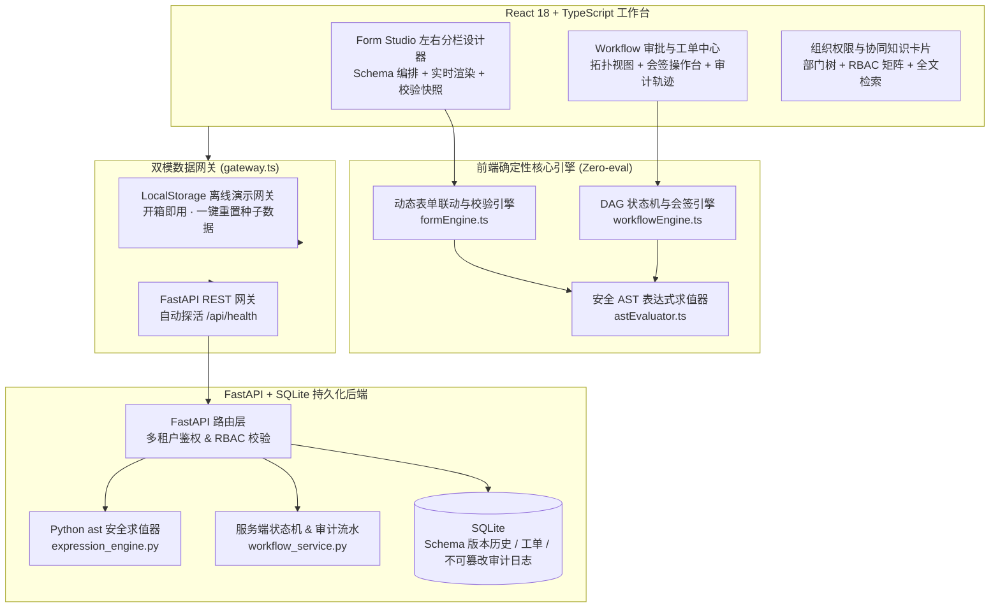

# OrgFlow Studio

> **元数据驱动的组织协同与动态表单应用底座** · Metadata-Driven Organizational Collaboration & Dynamic Form Workflow Engine

[](https://github.com/zhyzx35607/orgflow-studio/actions/workflows/ci.yml)
[](./LICENSE)
[](https://react.dev/)
[](https://fastapi.tiangolo.com/)

**OrgFlow Studio** 是一个面向组织协同与低代码业务编排的开源工作台，融合了**多租户空间隔离**、**JSON Schema 动态表单与安全 AST 公式引擎**、**可编排多级审批/会签状态机**以及**关联流程的协同知识卡片库**。

前端支持**双模网关无缝切换**：既可直连本地 `FastAPI + SQLite` 后端服务实现持久化与版本审计，也可在**零后端配置**下通过内置浏览器 `LocalStorage` 离线演示网关完整体验全部核心能力。

---

## 系统架构设计



---

## 核心特性详解

### 1. 安全沙箱 AST 公式引擎（Zero `eval`）
- **完全禁用 `eval` / `new Function` / 原型链遍历**：前后端分别实现确定性词法分析器与递归下降 AST 求值器（TypeScript `astEvaluator.ts` & Python `expression_engine.py`），显式拦截 `__proto__`、`constructor`、`window`、`__class__` 等危险标识符。
- **明细子表聚合与链式计算**：支持行内公式（如 `ROUND(qty * unitPrice, 2)`）与跨行聚合函数（`SUM(items, 'subtotal')`、`AVG`、`MIN`、`MAX`、`COUNT`），并支持多轮拓扑求值以实现级联公式（如 `明细净额 -> 含税总额 -> 大额 CFO 提示`）。
- **声明式联动与跨字段校验**：
  - `visibleWhen`：动态控制字段显隐（如 `procurementMode == 'sole_source'` 或 `grandTotal >= 50000`），隐藏字段自动跳过必填校验。
  - `crossFieldRules`：支持跨字段业务红线校验（如商务减免金额不得超过明细汇总的 50%）。

### 2. 可编排多级审批与会签工作流引擎（DAG / State Engine）
- **节点类型**：`start`、`serial_approval`（串行审批）、`parallel_countersign`（并行会签）、`condition_gateway`（条件分支网关）、`end`。
- **双模式并行会签**：
  - **全票通过（`unanimous`）**：所有会签人同意方可推进，任一驳回即刻终止流程。
  - **按比例通过（`ratio`）**：支持配置 `passRatio`（如 `0.66` 或 `0.5`），赞成票达到阈值即刻提前放行。
- **完整流转动作**：支持**同意、驳回、退回指定前置节点（`return_to_node`）、重新提交（`resubmit`）、同空间转交（`delegate`）**，并内置 **SLA 超时标记检测**与全链路不可篡改审计轨迹。

### 3. 多组织空间隔离与协同知识卡片
- **严格多租户隔离**：内置「星云智造协同空间 (`ws_nebula`)」与「海港生科研究院 (`ws_harbor`)」，部门树、角色权限矩阵、表单 Schema、审批工单与知识卡片均按 `workspaceId` 强隔离，跨空间操作自动拦截。
- **RBAC 权限矩阵**：支持 `schema:view`、`schema:edit`、`workflow:manage`、`ticket:submit`、`ticket:approve`、`doc:view`、`doc:edit`、`org:admin` 细粒度校验。
- **协同知识卡片**：制度红线、AST 公式手册与 SLA 规范可与表单 Schema 及流程模板直接关联，支持关键词与分类实时检索。

---

## 3 分钟快速体验指南

### 方式一：仅前端零配置启动（内置离线演示网关）

```bash
git clone https://github.com/zhyzx35607/orgflow-studio.git
cd orgflow-studio
npm install
npm run dev
```
打开浏览器访问 `http://localhost:5173`，即可在右上角切换**组织空间**与**成员身份**，体验 Form Studio 实时公式计算、动态显隐联动、并行会签与条件路由。

### 方式二：启动完整前后端（FastAPI + SQLite 持久化）

```bash
# 1. 启动后端服务 (port 8000)
cd backend
python -m venv .venv
# Windows: .venv\Scripts\activate  |  Linux/macOS: source .venv/bin/activate
pip install -r requirements.txt
uvicorn app.main:app --reload --port 8000

# 2. 另开终端启动前端 (Vite 已配置 /api 代理至 127.0.0.1:8000)
cd ..
npm run dev
```
在前端右上角网关下拉框切换为 **「FastAPI 后端网关 (在线)」**，所有 Schema 版本保存、工单流转与审计日志将持久化至 `backend/data/orgflow.sqlite3`。

---

## 自动化测试与构建验证

```bash
# 前端单元测试 (Vitest: AST 求值器、动态表单引擎、工作流状态机与 RBAC 共 25 项)
npm test

# 前端 TypeScript 类型检查与生产构建
npm run build

# 后端 API 集成测试 (Pytest: 多租户隔离、Schema 版本化、会签/路由/退回/转交/审计 共 20 项)
pytest backend/tests -v
```

---

## 目录结构

```text
orgflow-studio/
├── src/
│   ├── types/domain.ts              # 全量领域模型与元数据协议定义
│   ├── engine/
│   │   ├── astEvaluator.ts          # 安全确定性 AST 表达式解析与求值器
│   │   ├── formEngine.ts            # 动态表单联动、子表聚合与跨字段校验引擎
│   │   ├── workflowEngine.ts        # DAG 条件路由、全票/比例会签与审计状态机
│   │   ├── workspaceEngine.ts       # 部门树构建、RBAC 鉴权与知识卡片检索
│   │   └── __tests__/               # 25 项 Vitest 单元测试
│   ├── services/gateway.ts          # LocalStorage 离线网关 / FastAPI REST 网关
│   ├── data/seedData.ts             # 多租户演示种子数据
│   └── components/                  # Form Studio / Workflow Center / Workspace Docs 视图
├── backend/
│   ├── app/
│   │   ├── expression_engine.py     # Python ast 白名单安全求值器
│   │   ├── workflow_service.py      # 服务端工作流状态机与 SLA 检测
│   │   ├── database.py              # SQLite Schema 与种子数据初始化
│   │   └── main.py                  # FastAPI 应用与 REST 接口
│   └── tests/test_orgflow_api.py    # 20 项 Pytest API 集成测试
└── .github/workflows/ci.yml         # GitHub Actions 前后端持续集成流水线
```

## License

[MIT](./LICENSE)
